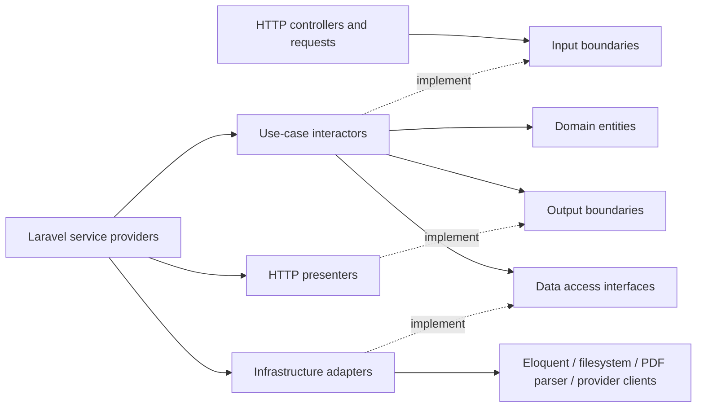

# Application architecture

## Overview

LWA uses **ports and adapters (hexagonal architecture)** for its Movies and
Library features, with explicit input and output boundaries inspired by Clean
Architecture (book). Business rules and application workflows live in plain PHP;
Laravel, persistence, external APIs, and HTTP presentation surround that core.

The application uses Laravel 12 and PHP 8.2+, with Vue 3, Inertia, Axios, and
Vite on the frontend. Inertia serves pages, while Axios calls HTTP endpoints
for interactive operations that return JSON.

This document describes the implemented architecture. Authentication and
profile management still follow Laravel's conventional controllers, requests,
and Eloquent model structure; they have not been organized into the same
explicit use-case boundaries as Movies and Library.

## Structure and responsibilities

| Location | Responsibility |
| --- | --- |
| `app/Domain/{Movies,Library}/Entities` | Business objects and their rules, independent of Laravel. |
| `app/Domain/{Movies,Library}/UseCases` | Application workflows, input/output ports, request/response data, and application exceptions. |
| `app/Domain/{Movies,Library}/UseCases/DataAccessInterfaces` | Ports for capabilities required by use cases, such as persistence or movie lookup. |
| `app/Domain/{Movies,Library}/UseCases/Data` | Plain PHP data transferred through those capability ports. |
| `app/Http/Controllers/{Movies,Library}` | HTTP entry points that invoke use cases and construct HTTP responses. |
| `app/Http/Requests/{Movies,Library}` | Laravel validation of incoming HTTP requests. |
| `app/Http/Presenters/{Movies,Library}` | Output adapters that turn use-case output into view models. |
| `app/Infrastructure/{Movies,Library}/Adapters` | Implementations of the capability ports. |
| `app/Infrastructure/Movies/HttpClients` | External-provider HTTP communication. |
| `app/Infrastructure/Library/Models` | Library Eloquent persistence models. |
| `app/Providers` | Composition: binds ports to implementations through Laravel's container. |
| `resources/js/Pages` and `resources/js/Components` | Vue pages, UI state, and reusable components. |
| `routes/web.php` and `routes/auth.php` | HTTP routing and middleware configuration. |
| `database/migrations` | Database schema changes. |

Although the directory is named `Domain`, it contains both domain entities and
the application use-case layer. These are separate responsibilities within the
same feature-oriented namespace tree.

## Understanding the layers through the Library feature

### Domain: what a valid business object is

`app/Domain/Library/Entities/Book.php` protects the rules for a book: its title
cannot be empty, title and author cannot exceed 255 characters, whitespace is
trimmed, and an empty author becomes `null`. These rules apply regardless of
whether the object is created through HTTP, a command, or a test.

The domain `Book` represents a business object. The Eloquent `Book` in
`app/Infrastructure/Library/Models` represents database persistence. Keeping
them separate lets business rules exist independently of Laravel and SQL.

### Application: what the app does

The application layer lives under `app/Domain/{feature}/UseCases`, even though
there is no separate `app/Application` directory. Interactors coordinate
operations; entities protect the rules of the business objects involved.

For example, `AddBookInteractor`:

1. Creates a domain `Book` to validate and normalize title and author.
2. Checks the PDF size limit.
3. Requests text extraction through `PdfTextExtractor`.
4. Requests PDF and optional cover storage through `BookFileStorage`.
5. Saves the book and pages through `BookRepository`.
6. Cleans up newly stored files if storage or persistence fails.
7. Sends the saved book to its output boundary.

The interactor decides which steps happen and in what order. Infrastructure
implements the technical details of extraction, storage, and persistence.

An input boundary is a PHP interface declaring an operation, not an HTTP
endpoint. A controller calls its `execute()` method with an `InputData` object.
`OutputData` carries the result to an output boundary. These data objects are
plain PHP values rather than Laravel requests or Eloquent models.

### Infrastructure: how external work happens

The core declares the capabilities it needs in `DataAccessInterfaces`.
Infrastructure supplies implementations, such as `EloquentBookRepository`,
`LaravelBookFileStorage`, and `SmalotPdfTextExtractor`.

When an interactor calls `$this->books->save(...)`, its declared dependency is
`BookRepository`. At runtime, the object supplied by Laravel is an
`EloquentBookRepository`. SQL queries and transactions stay in that adapter;
the interactor works with the interface and core data objects.

Movies uses the same separation: `MovieLookup` is implemented by
`TmdbMovieLookup`, while `StreamingOfferLookup` is implemented by
`WatchmodeStreamingOfferLookup`. Provider-specific HTTP clients and response
formats remain in infrastructure.

### Controllers and requests: the HTTP entrance

`LibraryController` reads request values and uploaded files, constructs input
data, invokes a use case, reads the presenter's view model, and returns JSON or
an Inertia page. It also maps application exceptions to HTTP responses.

`SaveBookRequest` validates the HTTP payload, including upload type and size.
Core validation still protects domain and application rules when the use case
is invoked without HTTP. The two checks protect different entry points.

### Presenters: preparing backend output

Presenters are backend PHP classes, separate from the Vue frontend.
`AddBookPresenter` implements `AddBookOutputBoundary` and converts the result
into a `ViewModel`:

```php
public function present(AddBookOutputData $output): void
{
    $data = ['book' => BookViewData::from($output->book)];
    $this->viewModel = new ViewModel($data);
}
```

`BookViewData` maps core properties such as `filePath` to response keys such as
`file_path`. The interactor produces the operation's result, the presenter
shapes it for presentation, the controller sends the HTTP response, and Vue
renders it on screen.

### Frontend: the user interface

Vue pages in `resources/js/Pages` and reusable components in
`resources/js/Components` handle forms, search fields, modals, notifications,
UI state, and rendering. Inertia connects Laravel responses to Vue pages;
Axios sends interactive requests and receives JSON.

For example, `resources/js/Pages/Library/Index.vue` searches books with:

```js
axios.get('/library/search', {
  params: { q: query }
})
```

The page updates its displayed books from the response. Business rules and
database access remain in the backend layers.

### Composition: assembling the objects

Service providers tell Laravel which concrete objects to supply when a class
requests an interface:

```php
$this->app->bind(
    BookRepository::class,
    EloquentBookRepository::class,
);
```

This means that a constructor requesting `BookRepository` receives an
`EloquentBookRepository`. Dependency injection is the act of supplying those
dependencies from outside the class; Laravel's container automates their
construction and wiring. Framework-free PHP can also use dependency injection
by constructing objects and passing dependencies manually.

An add-book request crosses the layers like this:

```text
Vue form
  -> Laravel route, authentication, and request validation
  -> LibraryController
  -> AddBookInteractor
      -> Domain Book rules
      -> PDF extractor
      -> File storage
      -> Book repository
  -> AddBookPresenter
  -> Controller returns JSON
  -> Vue updates the screen
```

This is runtime flow. Source dependencies still point toward the core through
interfaces, as explained below.

## Ports and adapters

A **port** is an interface owned by the application core. An **adapter** connects
that interface to a particular entry point or external technology.

Each use-case directory normally contains:

- `InputBoundary`: the operation available to a caller, typically `execute()`.
- `InputData`: plain PHP input for that operation.
- `Interactor`: the implementation of the input boundary and the workflow.
- `OutputBoundary`: the interface used to present the result.
- `OutputData`: the result passed to that output boundary.

Controllers act as driving adapters: they translate an HTTP request into input
data and call an input boundary. Presenters implement output boundaries and
prepare data for the HTTP/UI side. Infrastructure adapters implement the ports
that interactors use to access databases, storage, PDF extraction, and APIs.

An interactor therefore depends on interfaces such as `MovieLookup` or
`BookRepository`, rather than a specific API client or Eloquent model.

## Dependency direction

Source dependencies point toward the core. `app/Domain` does not import
Laravel, Inertia, HTTP controllers/presenters, infrastructure adapters, or
Eloquent models. HTTP and infrastructure code may depend on core types.



Arrows in this diagram represent source dependencies or interface
implementations. Runtime calls can cross an interface into an outer adapter:
for example, an interactor calls a presenter through its output boundary.
That does not create a source dependency on the concrete presenter.

## Request and response flow

For a typical interactive operation:

1. A Vue page sends an Axios request to a Laravel route.
2. Middleware handles authentication and configured throttling. A Form Request
   validates the HTTP payload where one is used.
3. The controller constructs `InputData` and calls the use case's `InputBoundary`.
4. The interactor applies application rules and calls its capability ports.
5. Infrastructure adapters perform the required external operations and return
   core data types.
6. The interactor sends `OutputData` to its `OutputBoundary`.
7. The presenter creates a `ViewModel`; the controller reads it and returns JSON
   or Inertia page props.
8. The Vue page updates its UI state from the response.

Input validation belongs at both relevant boundaries: HTTP validation checks
request shape, while core validation protects use cases even when invoked
without HTTP. Controllers translate application exceptions into HTTP statuses;
for example, unavailable providers become 503 responses and invalid arguments
become 422 responses. Library also maps missing books to 404 responses.

## Movies

Movies provides three use cases:

| Use case | Purpose |
| --- | --- |
| `FindMovieByTitle` | Look up a movie by its title. |
| `FindStreamingOffersForTitle` | Find streaming offers for a title and region. |
| `AnalyzeSubscriptionPlatforms` | Analyze subscription platforms for a selected movie list. |

The infrastructure implements these core capability ports:

| Port | Adapter |
| --- | --- |
| `MovieLookup` | `TmdbMovieLookup` |
| `StreamingOfferLookup` | `WatchmodeStreamingOfferLookup` |

`TmdbApiClient` and `WatchmodeApiClient` contain provider-specific HTTP
communication. Adapters translate provider responses into application data so
provider response formats do not become use-case contracts.

For example, `MoviesStreamingController::searchTmdbMovieTitle()` constructs
`FindMovieByTitleInputData` and invokes `FindMovieByTitleInputBoundary`.
`FindMovieByTitleInteractor` uses `MovieLookup`, then calls
`FindMovieByTitleOutputBoundary`. Its presenter adds display formatting such as
the movie label, and the controller returns the presenter's view-model data.

## Library

Library provides `ListBooks`, `SearchBooks`, `AddBook`, `UpdateBook`,
`DeleteBook`, and `SearchBookContents` use cases.

| Port | Adapter | External concern |
| --- | --- | --- |
| `BookRepository` | `EloquentBookRepository` | Book/page persistence and database transactions. |
| `BookContentSearch` | `EloquentBookContentSearch` | Searching persisted book contents. |
| `BookFileStorage` | `LaravelBookFileStorage` | File storage through Laravel. |
| `PdfTextExtractor` | `SmalotPdfTextExtractor` | Extracting PDF text with the Smalot parser. |

Domain `Book` and `BookPage` objects are separate from the Eloquent models with
the same names under `Infrastructure/Library/Models`. Persistence models stay
inside infrastructure; repository methods exchange `BookData` and other core
data objects with use cases.

Use cases coordinate multi-step operations such as extraction, file storage,
and persistence. For example, `AddBookInteractor` validates PDF limits,
extracts pages, stores files, saves the book, and cleans up newly stored files
if saving fails. Database transactions are handled inside the persistence
adapter; they do not make filesystem and database operations one transaction.

## Composition and presenter lifetime

`MoviesServiceProvider` and `LibraryServiceProvider`, registered in
`bootstrap/providers.php`, assemble each feature:

- Bind input boundaries to their interactors.
- Bind capability ports to concrete infrastructure adapters.
- Register presenters with a scoped lifetime.
- Resolve each output boundary to its corresponding scoped presenter.

The scoped presenter is significant: the controller and the interactor's
output boundary must resolve to the same presenter instance during an
operation. The controller can then read the view model populated by the
interactor's call to `present()`.

## Testing boundaries

- **Unit tests** exercise plain PHP use cases with substitute capability/output
  ports, and test presenter formatting independently where presenter tests exist.
- **Integration tests** exercise adapters, provider clients, persistence, and
  service-provider assembly.
- **Feature tests** exercise real HTTP routes, authentication, validation,
  container wiring, and responses.

Tests simulate external provider calls rather than relying on live services.
Database-backed tests use the in-memory SQLite configuration in `phpunit.xml`.
Library HTTP tests also use fake storage and generated PDFs. PHP feature tests
do not execute Vue; a frontend build checks compilation rather than browser
behavior. See [test organization](../tests/README.md) for commands and details.

## Extending the application

For a new business operation, define its input/output boundaries and data,
implement the interactor, and reuse or add capability ports in the core. Add
infrastructure adapters for external concerns, a presenter for output formatting,
and controller/request classes for the HTTP entry point. Wire the implementations
in the feature service provider and test each boundary at the appropriate level.

Keep business decisions in entities or interactors, provider/database details in
infrastructure, HTTP status handling in controllers, and display formatting in
presenters or Vue as appropriate. A replacement database or API provider should
usually require an adapter and binding change rather than changes to use-case
interfaces or business rules.
